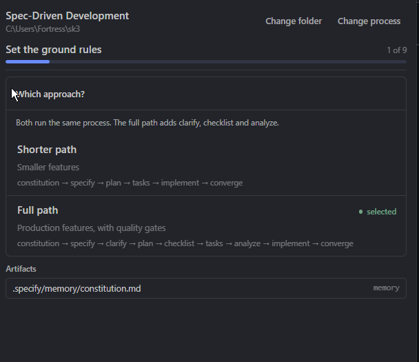
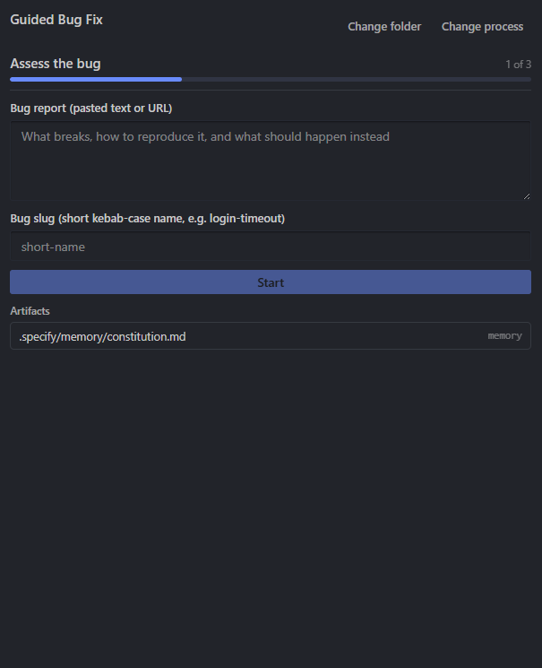
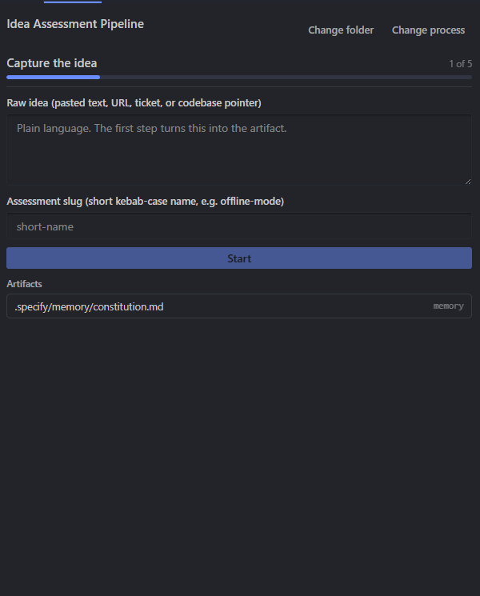

<p align="center">
  
</p>

<h1 align="center">Spec Kit for Hermes Desktop</h1>

<p align="center">
  <a href="LICENSE"></a>
  
  
  
  
</p>

<p align="center">Run spec-kit processes from a pane in Hermes Desktop, with every review gate in front of you.</p>

> [!NOTE]
> **Alpha.** Expect rough edges. Behaviour and file layout may change between releases.

Spec Kit is GitHub's toolkit for specification-driven development. It ships skills for your coding agent: constitution, specify, clarify, plan, tasks, analyze, implement, converge. In a terminal you call those skills one at a time and read the files they write. This pane puts the same process in the sidebar and keeps the files on disk.

Two things make it more than a launcher. The workflow stops at each review gate and opens the file it is reviewing, so you read and edit the spec before approving the plan. When a step produces nothing, the gate says so instead of reporting success.

## Table of contents

- [Screenshots](#screenshots)
- [Features](#features)
- [Requirements](#requirements)
- [Install](#install)
- [Updating](#updating)
- [Usage](#usage)
- [Troubleshooting](#troubleshooting)
- [Limitations](#limitations)
- [Development](#development)
- [Credits](#credits)
- [Contributing](#contributing)
- [License](#license)

## Screenshots

<p align="center">Spec Kit Plugin - Main Pane<p>

<p align="center"><p>

Spec Driven Development (Short/Full Paths):

| Spec Driven Development (Short/Full Paths) | Spec Driven Development - Short |
| --- | --- |
|  |  |

| Bug Fixing | Idea Assessment |
| --- | --- |
|  |  |

<!--
  New in this fork. Upload these files to docs/ and delete the comment markers.

| Main pane | Process chooser | Gate review |
| --- | --- | --- |
|  |  |  |
-->

## Features

| | |
|---|---|
| Three processes | Spec-driven development (10 steps), bug fixing (4 steps), idea assessment (7 steps). Each ships a complete workflow with gates. |
| Two SDD paths | Shorter path (6 steps) or full path (10 steps with clarify, checklist, and analyze gates). |
| Editable gates | Each gate opens the artifact in an editor with Approve and Reject. Saving is protected; if the file changed on disk you choose which version to keep. |
| Open questions | `[NEEDS CLARIFICATION]` markers become a form. Answers write back in place; blanks stay as markers. |
| Step output flagging | A step that changed no artifact is flagged at the gate. The file is the only honest signal. |
| Run control | Live log while a step runs, Stop button, one run per project, run history. |
| Kanban sync | Materialize spec-kit tasks as Kanban cards with idempotent links. |
| Integration health | Verify the Hermes adapter points at the correct project; re-apply the patch after CLI upgrades. |

## Requirements

- Hermes Desktop 0.22.2 or newer. The pane is a desktop plugin; the review gates dispatch skills through `hermes chat`, so the CLI must be on your PATH.
- The spec-kit CLI: `uv tool install specify-cli`.
- The `speckit-*` skills in your profile. `specify init --integration hermes` installs them.

The plugin runs on Windows, Linux, and macOS. The pane itself contains no platform-specific code; the Python backend uses standard library modules and FastAPI. If you hit a platform issue, file a bug.

## Install

The plugin has two halves that both go in the **Hermes root home** (not a profile directory):

- **Frontend** (desktop pane) → `$HERMES_HOME/desktop-plugins/spec-kit-hermes/plugin.js`
- **Backend** (Python router) → `$HERMES_HOME/plugins/spec-kit-hermes/dashboard/`

`$HERMES_HOME` defaults to:
- Windows: `%LOCALAPPDATA%\hermes`
- Linux/macOS: `~/.hermes`

Profiles live at `$HERMES_HOME/profiles/<name>/config.yaml`. The installer finds the root home automatically, copies both halves there, and adds the plugin to the target profile's `plugins.enabled`.

### From the registry (recommended)

```bash
hermes plugins install justinbrenton/speckit-hermes-desktop --enable
hermes gateway restart
```

That clones the repo into your Hermes home under `plugins/spec-kit-hermes`, enables it for the active profile, and the app loads the pane on next start. Quit every Hermes process and reopen. The pane appears as **Spec Kit** in the right sidebar with a matching status-bar chip.

### From a local clone

```bash
git clone https://github.com/justinbrenton/speckit-hermes-desktop
cd speckit-hermes-desktop
npm run build
node scripts/install.mjs
```

The installer copies both halves into the Hermes **root** home it finds and adds the plugin to `plugins.enabled` for the target profile (defaults to the active profile). Options: `--profile <name>` targets a profile, `--home <path>` a Hermes **root** home, `--dry-run` prints what would change.

### Manual install

```
plugin.yaml, desktop/, dashboard/  ->  <hermes root home>/plugins/spec-kit-hermes/
```

Add `spec-kit-hermes` to `plugins.enabled` in `<hermes root home>/profiles/<profile>/config.yaml`, then restart. The app discovers desktop plugins once per start, and the Python half is imported once per gateway process.

### Updating

Run the installer again. It detects the existing installation, backs up the previous `plugin.js` once (to `plugin.js.backup`), copies the new files, and reinstalls Python dependencies into the Hermes venv if needed.

```bash
# From a clone
cd speckit-hermes-desktop
git pull
npm run build
node scripts/install.mjs

# Or from the registry
hermes plugins install justinbrenton/speckit-hermes-desktop --enable
hermes gateway restart
```

The install script is idempotent. Running it on an existing installation upgrades the plugin in place without touching your projects or config.

### Uninstalling

```bash
hermes plugins remove spec-kit-hermes
hermes gateway restart
```

This removes the plugin from `plugins.enabled`. The copied files remain in the Hermes home; delete them manually if you want a clean slate.

## Usage

Open the **Spec Kit** pane from the right sidebar. Pick a folder by typing the path or using **Browse** (the pane walks directories itself because the plugin SDK has no native folder dialog).

Choose a process:

- **Spec-driven development** → then **Shorter path** or **Full path**
- **Bug fixing** → provide a bug report and a slug (kebab-case, e.g. `login-timeout`)
- **Idea assessment** → provide the raw idea and a slug (e.g. `offline-mode`)

Describe the work in a sentence or two and press **Start**. Each step dispatches a real agent call; give it a minute. When the run parks at a gate, the file under review opens below the progress bar. Read it, fix it, save it, then **Approve**. Approving runs the next step.

The constitution step runs first on the first pass and writes `.specify/memory/constitution.md` from the principles you type. After that, artifacts land in `specs/<number>-<name>/` for SDD, or `.specify/bugs/<slug>/` and `.specify/assessments/<slug>/` for the other two processes.

## Troubleshooting

### Pane appears but backend returns 404

The Python backend may not be mounted. This happens after a Hermes update because the gateway venv is recreated without the plugin's Python dependencies.

**Fix:** Re-run the installer. It installs the required dependencies (PyYAML, fastapi, pydantic) into the active Hermes venv.

```bash
node scripts/install.mjs --profile <your-profile>
```

Then restart Hermes completely.

### "Plugin backend unavailable" banner in the pane

The desktop plugin cannot reach `ctx.rest`. The backend is not mounted or the gateway is not running.

**Fix:** Same as above - re-run the installer and restart Hermes.

### Browse button does nothing

The folder picker falls back to the allowed listing. If your project is outside the configured browse roots, the backend refuses the path with a 403.

**Fix:** The `SPECKIT_ALLOWED_ROOTS` environment variable (or `allowed_roots` in the plugin config) controls which directories may be browsed. Ensure your project lives within one of those roots, or adjust the configured roots. The artifact-file allowlist (`.specify/spec.md`, `.specify/memory/constitution.md`, `.specify/tasks.md`) is separate and controls which files the backend can read/write inside the project.

### Skills not found at runtime

The `speckit-*` skills must be installed in the active Hermes profile.

**Fix:** Run `specify init --integration hermes` in a terminal, then restart Hermes.

### Linux-specific issues

#### PyYAML / "yaml not found" on Linux

The Hermes gateway clears `PYTHONPATH` when spawning the gateway process. If the plugin can't import `yaml`, the backend won't mount.

**Fix:** The plugin now auto-detects the site-packages directory at import time. If it still fails, ensure the Hermes venv has PyYAML:

```bash
# Find the Hermes venv (look in ~/.hermes/installs/.../venv/)
~/.hermes/installs/<install-id>/environments/<env-id>/venv/bin/python -m pip install PyYAML
```

Then restart Hermes Desktop completely.

#### Missing `python-multipart` or `psutil`

The gateway requires `python-multipart` for multipart form handling and `psutil` for process management.

**Fix:** Install into the Hermes venv:

```bash
~/.hermes/installs/<install-id>/environments/<env-id>/venv/bin/python -m pip install python-multipart psutil
```

Then restart Hermes Desktop.

#### Plugin not loading / "duplicate id" errors

If you cloned the repo into `~/.hermes/hermes-agent/speckit-hermes-desktop/`, the source directory may be loaded alongside the installed plugin.

**Fix:** Remove the source directory:

```bash
rm -rf ~/.hermes/hermes-agent/speckit-hermes-desktop/
```

#### Config YAML indentation

The `plugins.enabled` and `plugins.disabled` must be under `plugins:` key, not at root level.

**Fix:** Edit `~/.hermes/config.yaml`:

```yaml
plugins:
  isolation: in_process
  enabled:
    - spec-kit-hermes
  disabled: []
```

#### Missing `plugins.isolation`

If `plugins.isolation` is not set, it defaults to `host` which requires a plugin host process.

**Fix:** Add `isolation: in_process` under `plugins:` in `~/.hermes/config.yaml`.

### "Dispatched steps not told which project they are in" alert

The `specify` CLI's Hermes integration was missing the working-directory fix.

**Fix:** The plugin's repair mechanism automatically patches the integration files at runtime:
- `~/.cache/uv/archive-v0/*/specify_cli/integrations/hermes/__init__.py`
- `~/.local/share/uv/tools/specify-cli/.../site-packages/specify_cli/integrations/hermes/__init__.py`

Click "Re-apply fix" in the Spec Kit pane to re-apply the patches.

### "Browse" button does nothing

The folder picker falls back to the allowed listing. If your project is outside the configured browse roots, the backend refuses the path with a 403.

**Fix:** The `SPECKIT_ALLOWED_ROOTS` environment variable (or `allowed_roots` in the plugin config) controls which directories may be browsed. Ensure your project lives within one of those roots, or adjust the configured roots. The artifact-file allowlist (`.specify/spec.md`, `.specify/memory/constitution.md`, `.specify/tasks.md`) is separate and controls which files the backend can read/write inside the project.

### Skills not found at runtime

## Limitations

- Gates cannot be answered automatically. Approval is always a click.
- Only one workflow runs per project at a time. A second Start is refused while a run is live.
- Run state belongs to spec-kit; the pane reads it rather than keeping its own. If the gateway dies, the run cannot be recovered from the pane.
- The pane does not diff the code that `implement` and `converge` write. Those steps change files under your project directly.
- No native folder dialog. The plugin SDK has no file picker, so Browse lists directories through the backend and starts where you left it.
- Constitution preservation on hand-edited prose is not supported. The wizard regenerates the whole file.
- Kanban sync against your real board is not verified in the test suite (exercised against a throwaway `HERMES_HOME` only).

## Development

```bash
npm run build     # src -> desktop/plugin.js, fails if a referenced component is undefined
npm test          # pane decisions, build, installer
python -m pytest tests/backend -q -m "not hermes"   # routes, workflow bridge
```

Five backend tests need Hermes installed and cover dashboard mounting and the Kanban bridge: `python -m pytest tests/backend -q -m hermes`. See [docs/TESTING.md](docs/TESTING.md) for the full picture.

Before pushing, one command runs every gate:

```bash
npm run preflight
```

It builds, runs both suites, checks that every test count stated in the docs matches what just ran, and fails if `docs/design.html` is not what `docs/design.md` renders to.

`src/core.mjs` holds the decisions the pane makes about workflows it did not author: which inputs to ask for, where a run is, which file a gate reviews. `src/pane.js` is the UI. `dashboard/plugin_api.py` is the router: process discovery, run control, artifacts, clarification answers, and the integration health check.

## Credits

Built on [spec-kit](https://github.com/github/spec-kit) by GitHub. The processes, templates, workflow format, and skills are theirs; this repo is the pane and the backend around them.

## Contributing

Issues and PRs are welcome. A useful bug report includes:

- Hermes version (`hermes --version`)
- Platform and shell
- Steps to reproduce
- Expected vs actual behaviour
- Relevant logs (desktop.log, gateway.log)

## License

MIT. See [LICENSE](LICENSE).