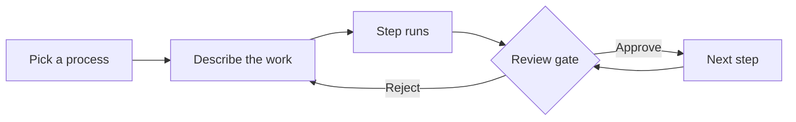

<p align="center">
  
</p>

<h1 align="center">Spec Kit for Hermes Desktop</h1>

<p align="center">Run spec-kit processes from a pane in Hermes Desktop, with every review gate in front of you.</p>

Spec Kit is GitHub's toolkit for specification-driven development. It ships skills for
your coding agent: constitution, specify, clarify, plan, tasks, analyze, implement,
converge. In a terminal you call those skills one at a time and read the files they
write. This pane puts the same process in the sidebar and keeps the files on disk.

Two things make it more than a launcher. The workflow stops at each review gate and
opens the file it is reviewing, so you read and edit the spec before approving the
plan. And when a step produces nothing, the gate says so instead of reporting success.

## How a run goes



The pane holds no workflow logic. spec-kit's own engine runs the steps, and the pane
renders what the engine reports: current step, artifacts, gate options, run history.

## What you get

| | |
|---|---|
| Three processes | Spec-driven development, bug fixing and idea assessment, read from whatever is installed. The pane offers to install the bug and assess extensions when they are missing. |
| Two paths | SDD asks first: the shorter path, or the full one with clarify, checklist and analyze as extra gates. |
| Editable gates | Each gate opens the artifact it reviews in an editor, with Approve and Reject underneath. Saving is protected, so a file changed by another tool offers the disk version or your version rather than overwriting it. |
| Open questions | `[NEEDS CLARIFICATION]` markers become a form. Answers are written back where the marker sat, and anything you leave blank stays a marker. |
| Step output | A step that changed no artifact is flagged at the gate. The engine calls that step completed, so the file is the only honest signal. |
| Control | Live log while a step runs, a Stop button, one run per project at a time, and the history of previous runs. |

## Requirements

- Hermes Desktop. The pane is a desktop plugin, and the review gates dispatch skills
  through `hermes chat`, so the CLI has to be on your PATH.
- The spec-kit CLI: `uv tool install specify-cli`.
- The `speckit-*` skills in your profile. `specify init --integration hermes` installs
  them.

Windows is the only platform this has been run on. Nothing in the pane is
platform-specific, but that is an untested claim elsewhere.

## Install

There is no `hermes plugins install` path for this. That command installs agent
plugins and portable packages from a catalog or repo, and this is a desktop plugin:
a JavaScript file the app loads from its plugin folder, plus a Python router it
mounts for file work. `hermes plugins list` does not show it, by design.

### With the installer

```bash
git clone https://github.com/justinbrenton/speckit-hermes-desktop
cd speckit-hermes-desktop
npm run build
node scripts/install.mjs
```

The installer copies both halves into the Hermes home it finds, and adds the plugin
name to `plugins.enabled` in the active profile's config after backing that file up.
`--profile <name>` targets a specific profile, `--home <path>` a specific Hermes
home, and `--dry-run` prints what it would change.

### By hand

Copy the built pane and the backend into place, then enable the backend half:

```
desktop/plugin.js   ->  <hermes home>/desktop-plugins/spec-kit-hermes/plugin.js
backend/plugin_api.py,
backend/manifest.json ->  <hermes home>/plugins/spec-kit-hermes/dashboard/
```

Add `spec-kit-hermes` to the `plugins.enabled` list in
`<hermes home>/profiles/<profile>/config.yaml`.

Either way, quit every `Hermes.exe` and the gateway `python.exe` before reopening.
The app discovers desktop plugins at startup, and the Python backend is imported once
per gateway process, so a file change alone will not reload it.

### When it does not appear

Check the file landed where the app looks, then prove the backend is mounted:

```bash
PYTHONPATH="$LOCALAPPDATA/hermes/hermes-agent" python scripts/verify-install.py --profile codie
```

It re-runs the app's own plugin discovery, mounts the router, and calls the routes. A
failure there is a real install problem; a pass means the pane is missing because the
app has not restarted. A banner in the pane does the same check at runtime for the
skill working directory, and offers to re-apply that fix.

## Use

Pick a folder, either by typing the path or with Browse. The pane walks directories
itself because the plugin SDK has no folder dialog.

Choose a process. For development that is Spec-Driven Development, then the shorter or
fuller path. Describe what you want in a sentence or two and press Start.

Each step dispatches a real agent call, so give it a minute. When it parks at a gate,
the file under review opens below the progress bar. Read it, fix it, save it, then
approve. Approving runs the next step.

The constitution step runs first on the first pass and writes
`.specify/memory/constitution.md` from the principles you type. After that, artifacts
land in `specs/<number>-<name>/`, or `.specify/bugs/<slug>/` and
`.specify/assessments/<slug>/` for the other two processes.

## What it will not do

- Answer a gate for you. Approval is a click, always.
- Run two workflows in one project at once. A second Start is refused while a run is
  live.
- Recover a run after the gateway dies. Run state belongs to spec-kit, and the pane
  reads it rather than keeping its own.
- Show you the code spec-kit writes. `implement` and `converge` change files under
  your project, and the pane does not diff them.
- Work from a folder picker. There is no folder dialog in the plugin SDK, so Browse
  lists directories through the backend.

## Development

```bash
npm run build     # src -> desktop/plugin.js, and fails if a referenced component is undefined
npm test
```

`src/core.mjs` holds the decisions the pane makes about workflows it did not author:
which inputs to ask for, where a run is, which file a gate reviews. `src/pane.js` is
the UI. `backend/plugin_api.py` is the router: process discovery, run control,
artifacts, clarification answers, and the integration health check.

The integration health check exists because of a local fix. Upstream's Hermes adapter
accepts the project path and ignores it, so a dispatched skill runs in the gateway's
workspace and writes outside your project. The pane patches that file and offers to
re-apply the patch, since upgrading the CLI replaces it.

## Credits

Built on [spec-kit](https://github.com/github/spec-kit) by GitHub. The processes,
templates, workflow format and skills are theirs; this repo is the pane and the
backend around them. The plugin id `spec-kit-hermes` is not used upstream.

MIT.
